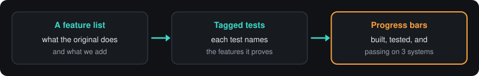

# tally

**tally draws progress bars that nobody updates by hand.** Each Raul project keeps a list of the features it must
have (for a rebuilt program, everything the original does) and its tests say which feature they prove. tally counts
both and draws how far along the project is: built, tested, and passing on Linux, Windows and macOS.

  

## What it looks like

The picture for [loot-rs](https://github.com/JorisJonkers-dev/loot-rs), redrawn on every change to its main branch:

  

## Why it helps

- 📋 **One list of what matters**: every feature, where it comes from, and its state.
- ✅ **Honest numbers**: a feature counts as covered only when a test for it passed on all three systems.
- 🔒 **No silent drops**: a removed feature or a falling count stops the change until someone says why.

## Learn more

- [Using tally](docs/USAGE.md): what it checks, its commands, adding it to a repository, development.
- [The catalogue format](docs/FORMAT.md) and [decisions](docs/adr).

Licence: GPL-3.0-only ([LICENSE](LICENSE)).
